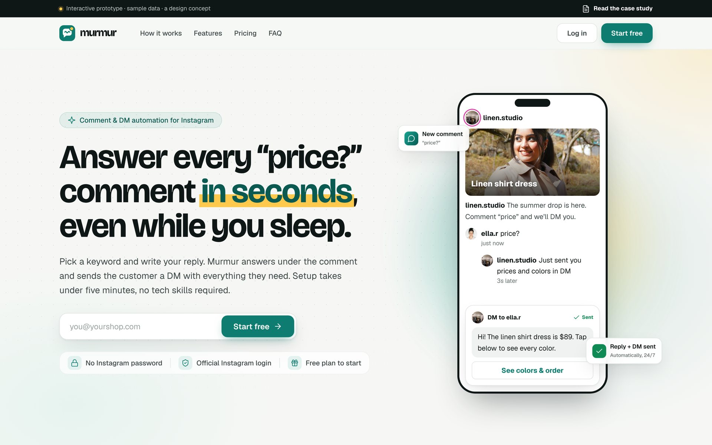
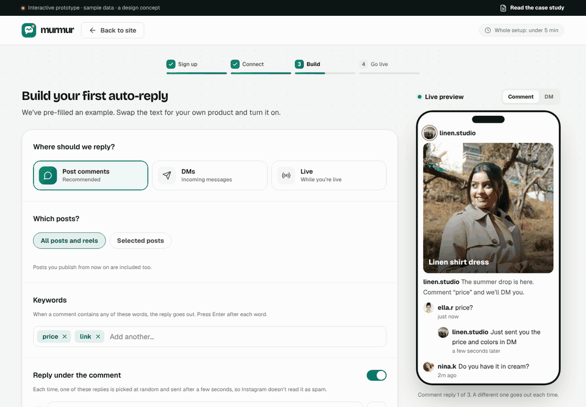
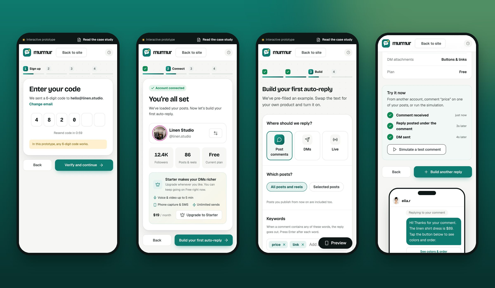

<p align="center">
  
</p>

<h1 align="center">Murmur</h1>

<p align="center">
  <b>From “price?” to a live auto-reply in under five minutes.</b><br>
  A design concept for Instagram comment &amp; DM automation: a landing page and a fully clickable onboarding flow.
</p>

<p align="center">
  <a href="https://itsrezaazizi.github.io/murmur-panel/"><b>Open the prototype</b></a> ·
  <a href="https://itsrezaazizi.github.io/murmur-panel/case-study.html"><b>Read the case study</b></a>
</p>

---

## What this is

Small shops on Instagram answer the same question all day: *“price?”*. Comment-to-DM tools already exist, but most of them ask a shop owner to build a flowchart before they see anything work.

Murmur is my take on the opposite approach: **show a working auto-reply first, then let people edit it.** The prototype covers the whole first session:

1. **Landing page:** headline, live phone demo, how it works, features, pricing, FAQ
2. **Sign up:** email + 6-digit code (auto-advance, paste, auto-submit)
3. **Connect:** official-login explainer, trust promises, help for personal accounts
4. **Build:** a pre-filled rule builder with a live phone preview (comment, DM and live)
5. **Go live:** a summary, time-to-live, and a simulated end-to-end test

> **Concept project.** Murmur isn’t a real product and wasn’t tested with users. There are no invented metrics here or in the case study.

<p align="center"></p>

<p align="center"></p>

## Things to try in the prototype

- Type a keyword and press <kbd>Enter</kbd>, then watch the comment preview rotate through your reply variations
- Add a **Voice note** on the Free plan to see how plan limits are explained inline (with a “Not now”)
- Switch **Where should we reply?** between post comments, DMs and Live
- Turn on **Auto follow-up** and look at the DM tab
- On the last step, press **Simulate a test comment**
- Resize the window: everything works down to 320px, with a full-screen preview sheet on mobile

Deep links: [`#signup`](https://itsrezaazizi.github.io/murmur-panel/#signup) · [`#connect`](https://itsrezaazizi.github.io/murmur-panel/#connect) · [`#builder`](https://itsrezaazizi.github.io/murmur-panel/#builder) · [`#done`](https://itsrezaazizi.github.io/murmur-panel/#done)

## Design system at a glance

| | |
|---|---|
| **Color** | Lagoon teal `#0E7C70` for every action, butter `#FFC94D` as a rationed accent, ink `#0F1716` on paper `#F6F7F5` |
| **Type** | Bricolage Grotesque (display) · Geist (UI) · Geist Mono (numbers) |
| **Spacing** | 4px scale: 4 8 12 16 20 24 32 40 48 64 80 96 |
| **Controls** | 36 / 40 / 44px heights; 44 for primary actions |
| **Grid** | 12 columns, 1248px max, 24px gutters |
| **Icons** | Lucide, 1.8px stroke |

The full reasoning (persona, principles, 13 key decisions and the copy glossary) is in the **[case study](https://itsrezaazizi.github.io/murmur-panel/case-study.html)**.

## Project structure

```
index.html          built prototype: one self-contained file (fonts, photos, icons inlined)
case-study.html     built case study
src/
  body.html         markup for the landing page + flow
  style.css         the design system and all components
  app.js            router, wizard, builder state, live preview (vanilla JS)
  case-study.html   case study source
fonts/              Bricolage Grotesque, Geist, Geist Mono (woff2, latin subset)
img/imgs.json       Unsplash photos, base64-encoded
docs/               screenshots and the demo GIF
tools/              Playwright scripts that render docs/
build.py            inlines everything into index.html and case-study.html
```

No framework, no bundler, no dependencies at runtime.

```bash
python3 build.py              # rebuild index.html + case-study.html
python3 tools/shots.py        # re-render screenshots (needs playwright + pillow)
python3 tools/gif.py          # re-record docs/demo.gif
```

Edit anything in `src/`, run `build.py`, and open `index.html` in a browser.

## Credits

- Design, UX writing and code: **Reza Azizi** ([@itsrezaazizi](https://github.com/itsrezaazizi))
- Photos: [Unsplash](https://unsplash.com) (Unsplash License)
- Icons: [Lucide](https://lucide.dev) (ISC)
- Fonts: [Bricolage Grotesque](https://fonts.google.com/specimen/Bricolage+Grotesque) and [Geist](https://vercel.com/font) (SIL Open Font License)

Murmur is a design concept and is not affiliated with Instagram or Meta. Instagram is a trademark of Meta Platforms, Inc.

## License

Code and design are released under the [MIT License](LICENSE). Photos, icons and fonts keep their own licenses listed above.
